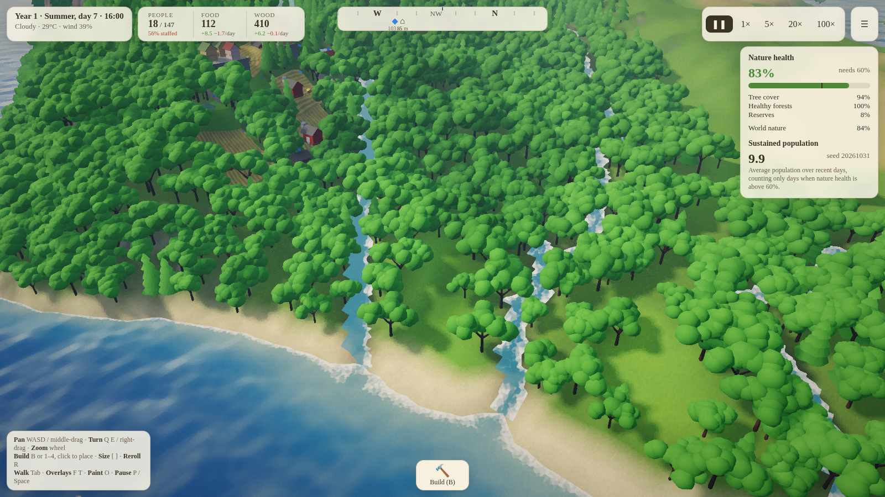
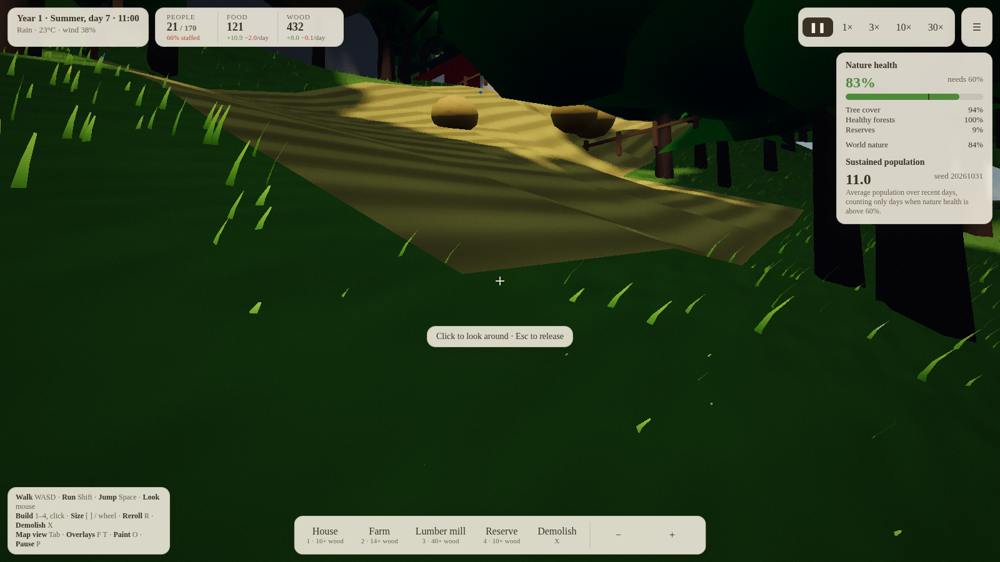
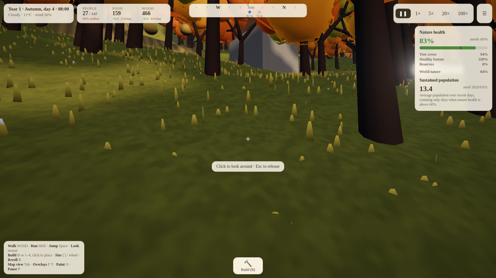
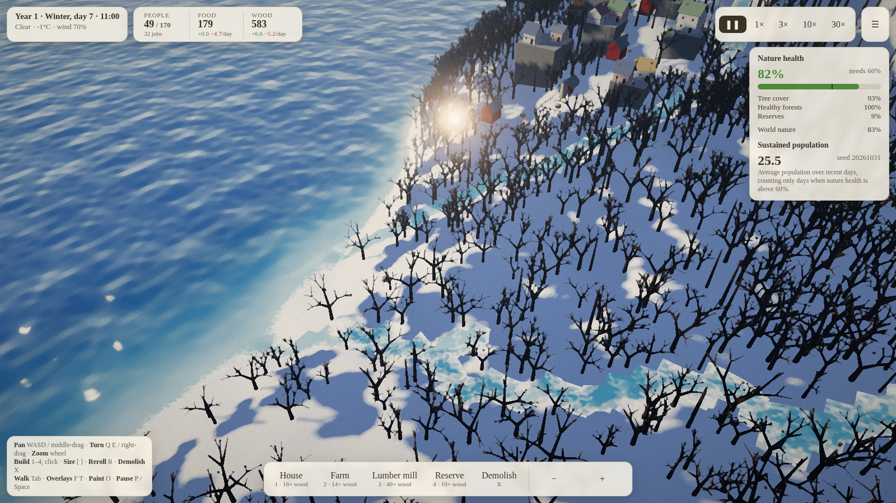
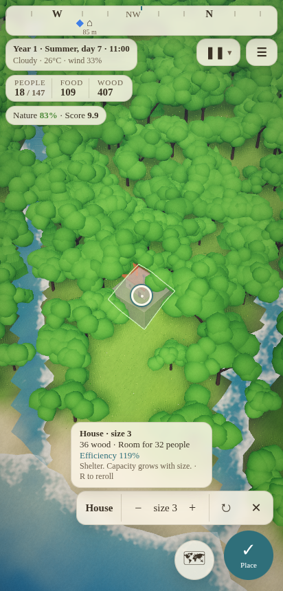

# GenTrification

A seeded ecology builder for the browser. The whole world (terrain, rivers, waterfalls,
forests, weather) grows from one seed. Your settlement is a log of placements on top of it.
A save is just numbers.

**Play:** https://jncchds.github.io/GenTrification/



| | |
|---|---|
|  |  |
|  |  |

## How to play

You walk the world in first person. Build where the crosshair points.

- **Goal:** keep as many people as you can, for as long as you can, while nature health
  around your village stays above 60%. The score is *sustained population*: the recent
  average population, counting only days when nature is healthy.
- **People** need food every day and firewood, more of it in the cold. Growth is fastest
  when there is room, food and warmth, and nature nearby is healthy.
- **Farms** only grow in warm weather. Stock up food before winter. Farming wears the soil;
  land left fallow recovers slowly.
- **Mills** cut the forest around them. Light cutting thins the forest and it regrows.
  Cutting faster than it grows strips the area bare, and bare ground only reseeds from
  neighbouring trees.
- **Reserves** protect nearby trees from mills, double their regrowth, and raise nature health.
- **Beacons** are cheap waymarkers with a light beam you can see from far away. The
  compass at the top shows every beacon (in its owner's colour) and your latest building.
- Every building rolls ±20% efficiency and sometimes a quirk (Cozy, Greedy saws,
  Rotational…). Press **R** before placing to reroll.
- Walking follows the land: climbs are slower, slopes steeper than about 45° can't be
  climbed (jump onto ledges), and very steep ground makes you slide.
- Each season has its own weather. Spring: mild, with showers. Summer: warm and mostly
  sunny, with afternoon thunderstorms. Autumn: grey and wet, with gales and morning fog.
  Winter: snow, frosty clear nights and blizzards.

### Controls

| | Desktop | Touch |
|---|---|---|
| Walk / look | WASD + mouse (click to capture), Shift to run, Space to jump | Left thumb joystick, drag to look, ⤒ to jump |
| Build | B (or 1–5) opens the build menu, click to place, `[` `]` or wheel for size, R reroll, X demolish, Esc cancel | 🔨 opens the menu, pick a building, then ✓ places it at the crosshair (− + ↻ ✕ above it) |
| Map view | Tab (WASD pan, middle-drag to grab the map, right-drag turn, wheel zoom; build where the mouse points) | 🗺 (drag pans, pinch zooms, twist turns; build at the pin in the middle of the screen, tap a spot to glide there, ✓ to place) |
| Other | P pause, F fertility overlay, T tree overlay, O paint filter, M menu | Speed button (tap to choose), ☰ menu |

The top of the screen adapts to the device: clock, resources and nature stack on the left on
narrow screens and phones, the compass sits at the top centre (across the whole top row in
portrait), and game speed is one button that opens a small list.

The menu has new worlds from a seed, save codes (copy or paste), and multiplayer.

## Running locally

```bash
npm install
npm run dev           # http://localhost:5173
npm test              # determinism + multiplayer tests
npm run build         # static build in dist/
```

URL options for testing: `?seed=123`, `?demo=18` (a bot builds a village for 18 days),
`?hour=17`, `?view=map`, `?mobile=1`, `?hud=0`. Screenshots:
`node tools/shot.mjs out.png "demo=18&hour=10"`. Touch controls on an emulated phone:
`node tools/touchtest.mjs`. Both need the dev server and Chrome.

To try it on a phone on the same network, run `npm run dev` and open
`http://<your computer's LAN IP>:5173/`.

## Multiplayer

```bash
npm run build && npm run server      # ws + static on :8787
```

Open `http://<host>:8787/?server=ws://<host>:8787&room=valley&name=Ada`, or use **Join**
in the menu. GitHub Pages only hosts the client, so multiplayer needs this server running
somewhere. A Pages page served over `https` needs a `wss://` server address.

## More

- [Design](design.md): the brief, and the decisions made since
- [Architecture](architecture.md): determinism rules, sim/render split, log format, protocol
